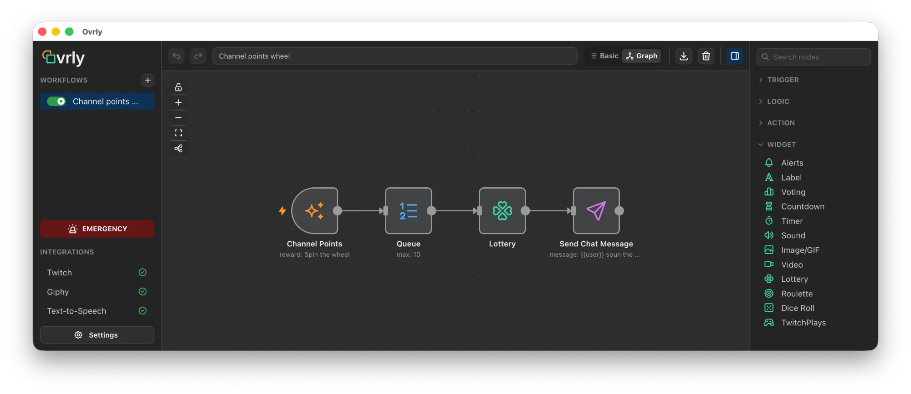

# <picture><source media="(prefers-color-scheme: dark)" srcset="docs/public/wordmark-dark.svg"></picture>

> Node-based automation for live stream interactions.

[](https://github.com/petitbonney/ovrly/releases)
[](https://github.com/petitbonney/ovrly/releases)
[](https://github.com/petitbonney/ovrly/actions/workflows/test.yml)
[](https://petitbonney.github.io/ovrly/)
[](LICENSE)

Ovrly connects stream events (Twitch chat, follows, subs, raids, channel points, Stream Deck keys) to actions (overlays, OBS scenes, Philips Hue lights, key presses, HTTP calls) by drawing a graph, the way n8n works, but for streamers. It runs on your computer; the editor opens in your browser.



**Status:** prototype. Twitch and OBS only.

## Documentation

**[petitbonney.github.io/ovrly](https://petitbonney.github.io/ovrly/)**

- **[Streamers](https://petitbonney.github.io/ovrly/streamer/)**: download, first workflow, templates, widgets in OBS, connecting Twitch, OBS, Stream Deck and Hue.
- **[Developers](https://petitbonney.github.io/ovrly/developer/)**: architecture, HTTP API, writing nodes and widgets, custom types, contributing.

The docs' source is in [docs/](docs/).

## Download

Grab the installer for your OS from the [Releases page](https://github.com/petitbonney/ovrly/releases): a `.dmg` for macOS (Apple Silicon or Intel), a setup `.exe` for Windows. Ovrly opens in its own window, and keeps running in the tray when you close it.

## From source

```bash
pnpm install
pnpm dev      # server + UI on http://localhost:6875
```

## Versioning

Ovrly uses calendar versioning: `YYYY.M.MICRO`, e.g. `2026.11.0`, then `2026.11.1` for the next release that month. The version says when a release was made, not how much changed: breaking changes are called out in the release notes.

A release is a `vYYYY.M.MICRO` tag on `master`: CI tests it, builds the installers and publishes the GitHub release. `package.json` stays at `0.0.0-dev`, as the tag sets the version.

## License

GPL-3.0-or-later. See [LICENSE](LICENSE).
