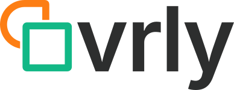
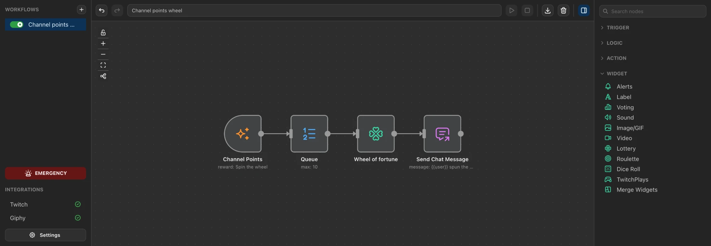

# <picture><source media="(prefers-color-scheme: dark)" srcset="docs/public/wordmark-dark.svg"></picture>

> Node-based automation for live stream interactions.

Ovrly connects stream events (Twitch chat, follows, subs, raids, channel points, Stream Deck keys) to actions (overlays, OBS scenes, Philips Hue lights, key presses, HTTP calls) by drawing a graph, the way n8n works, but for streamers. It runs on your computer; the editor opens in your browser.



**Status:** prototype. Twitch and OBS only.

## Documentation

**[petitbonney.github.io/ovrly](https://petitbonney.github.io/ovrly/)**

- **[Streamers](https://petitbonney.github.io/ovrly/streamer/)**: download, first workflow, templates, widgets in OBS, connecting Twitch, OBS, Stream Deck and Hue.
- **[Developers](https://petitbonney.github.io/ovrly/developer/)**: architecture, HTTP API, writing nodes and widgets, custom types, contributing.

The docs' source is in [docs/](docs/).

## Download

Grab the zip for your OS from the [Releases page](https://github.com/petitbonney/ovrly/releases), unzip it, and double-click **Start Ovrly.command** (macOS) or **Start Ovrly.bat** (Windows). Node is bundled; your data stays in the `data` folder next to it.

## From source

```bash
pnpm install
pnpm dev      # server + UI on http://localhost:6875
```

## License

GPL-3.0-or-later. See [LICENSE](LICENSE).
